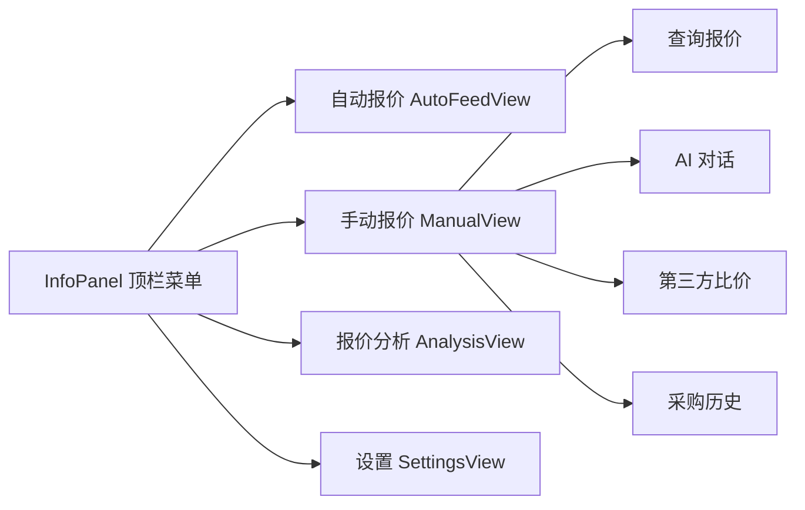
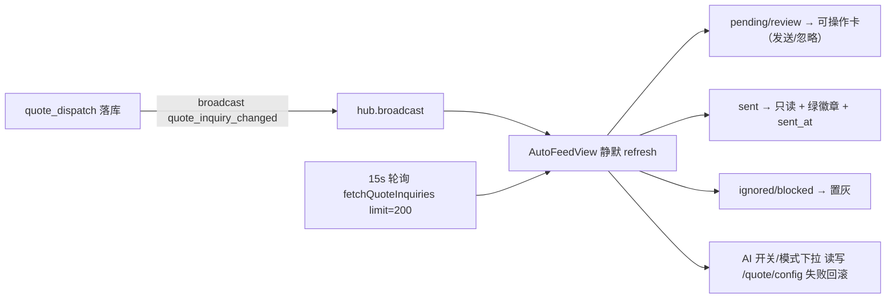

# 拓展栏按原型完全重做方案（快捷报价 4 视图 · 全真实后端）

## Context

当前右栏拓展栏（InfoPanel.vue：报价列表 + 简易设置）与原型 `prototypes/quick-quote-panel/` 完全不同。原型规范为 4 视图：**自动报价**（AI 开关 + 报价模式下拉 + 新消息触发流 feed + 暂停）、**手动报价**（查询报价/AI 对话/第三方比价/采购历史 4 子 tab）、**报价分析**（日报/月报 KPI + 趋势柱图 + TOP 配件）、**设置**（基础识别配置/价格映射/黑名单/话术模板/通知配置）。

后端 `backend/qq_client.py` 已封装全部 11 个上游查询（vininfo/partno/product_list/part_images(_list)/purchase_history/zpy/jqr/extract_parts/ocr_vin），但没有暴露 HTTP 端点；无统计端点；WS 只有 new_message/send_result 事件。

**用户已拍板**：① 手动报价 4 子 tab 全部接真实后端（新增代理端点）；② 报价分析真实聚合（新增统计端点）；③ 设置页话术模板/通知配置按原型样式渲染但置灰「待后端支持」。

约束（用户规范）：一文件一职责 ≤400 行；函数 ≤80 行；核心业务写单测；先流程图后代码。

## 流程图（业务代码的前提）

### 1. 视图路由（InfoPanel 壳）



### 2. manual-search 链式查询（后端编排，任一步失败 502 + 步骤名）

```mermaid
flowchart TD
  S{detectType q} -->|17位 VIN| V["vininfo(vin) → 未命中即 502「VIN 未命中」"]
  S -->|OE 正则| O[product_list(number) 直查]
  S -->|名称| N["partno(默认VIN, name) → oeCodeTrim 空 = 502 译码失败"]
  V --> P{partno 译出 OE?}
  N --> P
  P -->|是| PL[product_list(oeCodeTrim)] --> PI[part_images → imageId] --> PIL[part_images_list 爆炸图] --> R["r = {car, product, partImagesList, chain}"]
  P -->|否/oe分支| R2["r = {car?, product, chain}"]
  O --> R2
```

### 3. 自动报价 feed 数据流



### 4. 报价分析聚合（GET /api/quote/stats）


## 后端新增契约

### backend/api/quote_query.py（新，全部 `@require_role()`；QuoteApiError → `502` + msg 带步骤名；缺参 400）

| 路由 | 入参 | 出参 data |
|---|---|---|
| POST `/api/quote/query/manual-search` | `{q, part_name?}` | `{car?, product?, partImagesList?, chain:[...]}`（编排见流程图 2，name 分支默认 VIN `WBAWX3100G0L69595` 语义同原型） |
| POST `/api/quote/query/extract-parts` | `{text}` | `{list:[{sender_name, part_name, vin, oem_no, quoted}]}`（组装 chat_content 调 extract_parts） |
| POST `/api/quote/query/zpy` | `{number}` | 上游中文键列表原样透传 |
| POST `/api/quote/query/jqr` | `{number}` | `{jy_data:[...], xj_data}` |
| POST `/api/quote/query/purchase-history` | `{number, page=1, limit=10}` | `{total:{purchase_quantity,totalprice}, list:{...}}` |

在 app.py 照 quote_inquiry_bp 模式注册。

### backend/api/quote_stats.py（新）

- GET `/api/quote/stats?period=day|month`；period 非法 400。口径与 quote_inquiry 列表一致（join Conversation 限绑定设备）。聚合用 Python 分桶（不用 SQL date 函数，跨 SQLite/MySQL 且好造数），范围限最近 10 周。

### WS 广播（小幅增强，让 LIVE 名副其实）

- `backend/services/quote_dispatch.py`：dispatch commit 后（quote_inquiry_changed, created=True）；`backend/api/quote_inquiry.py` send/ignore 状态回写后（created=False）。前端只当「静默 refresh 信号」。

## 前端组件拆分（每文件 ≤400 行）

| 文件 | 职责 |
|---|---|
| `InfoPanel.vue`（重写） | 顶栏 4 菜单 + `<component :is>` 切换壳（~140 行）；轮询移交 AutoFeedView |
| `components/right/AutoFeedView.vue`（新） | AI 开关/模式下拉/徽章（读写 /quote/config，403 恢复原值+toast）+ feed 三态卡 + 暂停 + 15s 轮询 + WS 监听（~340 行） |
| `components/right/ManualView.vue`（新） | 4 子 tab 容器 + 查询报价子 tab（输入/chips/loading/错误态）（~300 行） |
| `components/right/ManualAiChat.vue`（新） | AI 对话：文字走 extract-parts 展示场景；图片/文件置灰 tooltip 待后端支持（~180 行） |
| `components/right/ManualThirdParty.vue`（新） | zpy/jqr 表格，最低价高亮，价格统一 String 化（~150 行） |
| `components/right/ManualHistory.vue`（新） | 采购汇总卡 + 分页表格（~130 行） |
| `components/right/QuoteResultCard.vue`（新） | 手动查询结果卡（原型 quoteCardHTML 结构）：车线/缩略图/价格行含改价（`_price` 联动话术与省比）/品牌比价表/爆炸图表/动作区（~380 行） |
| `components/right/AnalysisView.vue`（新） | 日/月报切换 + KPI + CSS 柱状趋势 + TOP 列表（~250 行） |
| `QuoteSettings.vue` → `components/right/SettingsView.vue` | 保留真实字段读写；话术模板/通知配置按原型样式渲染但 disabled +「待后端支持」徽章（~280 行） |
| `utils/quoteQuery.js` + `.test.js` | detectType（vin 17 位、oe 正则、name）+ quoteText 组装 + 归一化 |
| `utils/quoteStats.js` + `.test.js` | days/series 对齐补 0、trend 符号、柱高百分比换算 |

**去留**：QuoteCard.vue **保留**（feed 卡主体，price_json 契约不变）；QuoteSettings.vue 改造为 SettingsView.vue 后删除旧文件。

**api/index.js 新增**：`qqManualSearch(q, partName)`、`qqExtractParts(text)`、`qqZpy(number)`、`qqJqr(number)`、`qqPurchaseHistory(number,page,limit)`、`fetchQuoteStats(period)`；查询类统一 `{ timeout: 60000 }`（uploadFile 先例）。

## 关键交互决策

1. **手动卡「发送报价」**：pinia chat store 已有 `currentId` 与 sendText/sendMedia 动作（[chat.js](file:///g:/work/BBR/FLASK/wx_app/frontend/src/stores/chat.js) L346/L359 均有 currentId 守卫）。`currentId` 为空 → 按钮 disabled + tooltip「请在工作台选中会话」；否则**图前文后**：`sendMedia(2, '', {url: product.image})` 成功后 `sendText(quoteText(r))`（改价 `_price` 联动）。纯前端发送，不走询价流水线，与原型语义一致。
2. **feed 映射**：`fetchQuoteInquiries({limit:200})` 前端分桶；pending/review 可操作、sent 只读、ignored/blocked 置灰；15s 轮询 + WS 静默 refresh + 动作后 emit refresh。
3. **配置读写回滚**：fetchQuoteConfig 回填；保存失败（含客服 403）恢复本地原值 + ElMessage.error 后端文案。

## 测试

- `backend/tests/test_api_quote_query.py`：mock 模式沿用 test_auto_quote.py 的 `monkeypatch.setattr(qq_client, "vininfo", ...)` 模式；覆盖 vin 全链/oe 直查/name 译码/VIN 未命中 502/QuoteApiError 502/缺参 400/zpy/jqr/采购历史。
- `backend/tests/test_api_quote_stats.py`：空库全 0、day/月分桶与 trend 差值、top 排序取 5、设备隔离、period 非法 400。
- `test_auto_quote.py` 追加广播断言用例（monkeypatch broadcast 捕获事件）。
- `frontend/tests/utils/quoteQuery.test.js` + `quoteStats.test.js`（vitest，detectType 边界含 I/O/Q 拒判）。

## 实施顺序（8 工作包，每包有验收）

1. 后端 quote_query.py + app.py 注册 → 单测命中 mock 上游，502/400 映射正确
2. 后端 quote_stats.py + 广播点（dispatch/send/ignore）→ 出参结构与口径符合
3. 两个 pytest 测试文件全绿，`pytest backend/tests` 无回归（当前基线 443 绿）
4. api/index.js + utils 两个 + vitest 绿
5. InfoPanel.vue 重写 + SettingsView.vue → 4 菜单切换、设置真实字段保存、403 toast
6. AutoFeedView.vue → 配置回滚、feed 三态、WS 静默刷新
7. ManualView + 3 子组件 + QuoteResultCard → 四子 tab 真实数据、改价联动、发送到当前会话
8. AnalysisView.vue + 浏览器端到端验证（全视图回归走查 + 按钮全部响应）

每 2-3 个工作包做一次重构检查（用户规范）；提交按 `feat:`（后端/前端可分批），重构单独提交。

## 验证

1. `G:\work\BBR\FLASK\wx_app\.venv\Scripts\python.exe -m pytest backend/tests`（全绿）
2. `cd frontend; npm run test`（vitest 全绿）
3. 后端 5000 + 前端 5173 起，浏览器实测：4 菜单切换；自动报价 feed 出真实询价卡、AI 开关/模式下拉保存与 403 回滚；手动查询 4 子 tab（OE/VIN/名称 chips 真实出卡、AI 对话真实解析、zpy/jqr/采购历史真实表格）；分析日/月报出数；设置保存与置灰区展示；卡片改价联动话术、无会话时发送禁用。
4. 全部通过后 `feat:` 提交。
